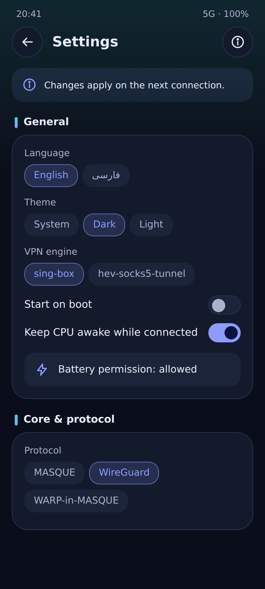
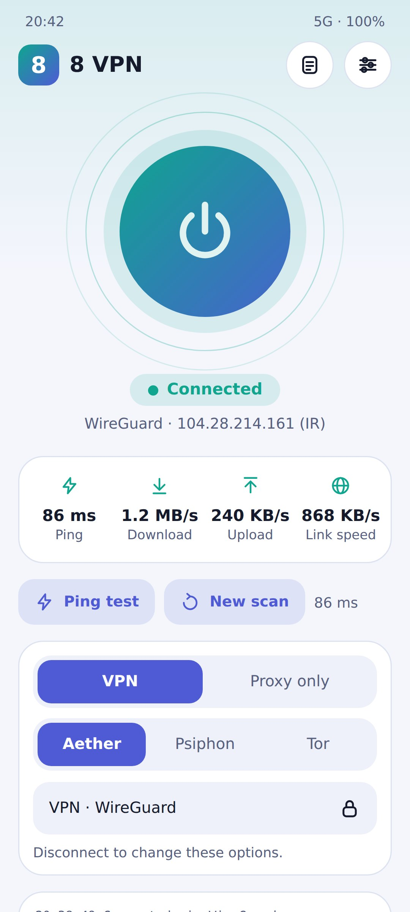

<div align="center">


**[English](#english) · [فارسی](#فارسی)**

[](https://t.me/Clubapp8)
[](LICENSE)


</div>

---

<a id="english"></a>

# 8 VPN — English

A lightweight Android VPN client built on the **Aether** core, with **sing-box** (libbox) as the default TUN engine and **hev-socks5-tunnel** as the fallback.
Jetpack Compose, Material 3, dark by default, English and Persian (RTL).

📢 Telegram channel: <https://t.me/Clubapp8>

## Features

- **Two modes**: VPN (the whole device goes through the tunnel) or Proxy-only (a local SOCKS5 and optional HTTP proxy).
- **Route switcher**: Aether, Aether → Psiphon, Aether → Tor, Psiphon only, Tor only, and the reverse routes (Psiphon → MASQUE, Tor → MASQUE).
  Aether protocols: MASQUE, WireGuard, WARP-in-MASQUE (Gool), WARP-in-WARP (Gool classic) and MASQUE-in-MASQUE. Psiphon has region and mode selection, Tor has bridge options.
- **Smart reconnect**: reconnects when the core dies, when pings fail, or when the network changes (Wi-Fi ↔ mobile data). It retries with a fresh gateway scan, or goes back quickly to the last working gateway.
- **Custom endpoint**: set your own gateway `IP:port` (outer and inner hop) and skip the scan.
- **Share the proxy with other devices**: let a laptop or another phone use the SOCKS5 / HTTP proxy through your hotspot or USB tethering. The app shows the addresses to enter.
- **Split tunneling**: include only selected apps or exclude them.
- **Routing rules**: block list and direct list (domains, IPs, CIDR, ports), custom DNS inside the tunnel, upstream proxy (`socks5://` or `http://`).
- **Pause and resume**: the Stop button turns the VPN off while the core keeps running, so Start resumes at once.
- **Tuning**: scan level, obfuscation profile, IP version, performance profile, TUN MTU, TCP buffer, ping interval and failure count, connection attempts and delay, extra Aether arguments.
- **Live info**: ping, download/upload speed, link speed, exit IP with country flag, the reason of the last drop, and logs you can copy or share.
- **Update check**: checks the latest GitHub release from the About screen. It never downloads or installs anything by itself.
- Quick Settings tile, start on boot, battery-optimization shortcut, dynamic color (Android 12+), dark / light theme.
- English and Persian UI with full RTL support.

## Screenshots

<p align="center">
  
  
  
  
  
</p>

## How it works

```
VPN mode:    apps -> VpnService (TUN) -> sing-box (gVisor stack) -> SOCKS5 127.0.0.1:1819 -> Aether / Psiphon / Tor -> internet
Proxy-only:  apps -> SOCKS5 127.0.0.1:1819 (or HTTP 127.0.0.1:1822) -> Aether / Psiphon / Tor -> internet
```

Ports: SOCKS5 `1819` (configurable), Tor `1820`, Psiphon `1821`, optional HTTP `1822` (configurable).

**TUN engines** (Settings → VPN engine):

- **sing-box** (default): DNS is answered by sing-box (DNS over TCP through the proxy). For Psiphon and Tor, non-DNS UDP is refused at once, so apps fall back from QUIC to TCP.
- **hev-socks5-tunnel**: the lightweight alternative. The app falls back to it automatically if the sing-box library is missing or fails to start.

## Engines and credits


| Component | Role | Link | License |
|---|---|---|---|
| **Aether** (CluvexStudio) | Core engine used for every route | <https://github.com/CluvexStudio/Aether> | AGPL-3.0 |
| **sing-box** (libbox) | Default TUN engine (gVisor stack) | <https://github.com/SagerNet/sing-box> | GPL-3.0 with extra terms |
| **Psiphon** (psiphon-tunnel-core) | Censorship circumvention route | <https://github.com/Psiphon-Labs/psiphon-tunnel-core> | GPL-3.0 |
| **Tor** | Onion routing route | <https://www.torproject.org> | BSD-3-Clause |
| **Lyrebird** | Tor pluggable transports (obfs4, webtunnel) | <https://gitlab.torproject.org/tpo/anti-censorship/pluggable-transports/lyrebird> | BSD-3-Clause |
| **hev-socks5-tunnel** | Fallback TUN → SOCKS5 engine | <https://github.com/heiher/hev-socks5-tunnel> | MIT |

> Please check each upstream repository for its current license terms.

## Build with GitHub Actions

1. Upload this project to your repository (`Mrmmd2004/8vpn`).
2. Open **Actions → Build APKs → Run workflow** (or push to `main`, or push a tag like `v5.8` to also create a release).
3. Download the `8VPN-apks` artifact:
   `8VPN-armeabi-v7a.apk`, `8VPN-arm64-v8a.apk`, `8VPN-universal.apk` (v7a + v8a + x86_64).

The workflow has three jobs: **native** (Aether with Tor, Psiphon, Lyrebird and hev-socks5-tunnel for three ABIs), **libbox** (sing-box library) and **apk** (Gradle release build).
The first build is slow (Rust + BoringSSL + Tor + Go).

**Signing (required).** The CI build fails without a fixed key, because debug-signed APKs cannot update each other. Add these repository secrets once and keep the same key forever:
`KEYSTORE_BASE64`, `KEYSTORE_PASSWORD`, `KEY_ALIAS`, `KEY_PASSWORD`.

**Versions.** `AETHER_REF`, `HEV_REF` and `SINGBOX_REF` at the top of `.github/workflows/main.yml` pick the upstream versions.
Defaults: Aether `v2.4.0`, hev-socks5-tunnel `2.19.0`, sing-box `v1.13.21`. When running the workflow by hand you can pass:

- `aether_repo` (for example your own fork with a changed core) and `aether_ref` (tag, branch or full commit hash). Note that commit `21e7150` is the commit just before pull request #141 and is older than v2.2.0, so it lacks `--gool-peer` and `--gool-classic`.
- `singbox_ref` to build the libbox library from another sing-box tag.

`libbox.aar` is built by the `libbox` job (tags `with_gvisor` + `with_clash_api` and a few small ones, arm + arm64) and placed in `app/libs/`.
For a local Gradle build, put a `libbox.aar` into `app/libs/` first.

## Notes

- Aether is AGPL-3.0, so this project is AGPL-3.0 too (see [LICENSE](LICENSE)).
- Aether's trademark policy asks derivative products to use their own name and branding, so the app is named **8 VPN** and the core is only credited.
- The Psiphon region list is static; the real set depends on Psiphon's servers.
- Sharing the proxy lets anyone on the same hotspot or Wi-Fi network use it. Use a strong hotspot password and turn sharing off when you are done.
- `8vpn-fix5/` and `backup-old-ui/` are old patch and backup folders kept for reference. They are not part of the build.

---

<a id="فارسی"></a>

<div dir="rtl" align="right">


# 8VPN — فارسی

یک کلاینت سبک VPN برای اندروید، ساخته‌شده روی هسته‌ی **Aether**، با **sing-box** (کتابخانه‌ی libbox) به‌عنوان موتور پیش‌فرض TUN و **hev-socks5-tunnel** به‌عنوان جایگزین.
با Jetpack Compose و Material 3، پیش‌فرض تیره، با رابط فارسی (راست‌به‌چپ) و انگلیسی.

📢 کانال تلگرام: <https://t.me/Clubapp8>

## امکانات

- **دو حالت**: VPN (کل دستگاه از تونل رد می‌شود) یا فقط پروکسی (یک SOCKS5 محلی و در صورت نیاز پروکسی HTTP).
- **انتخاب مسیر**: Aether، Aether ← Psiphon، Aether ← Tor، فقط Psiphon، فقط Tor و مسیرهای معکوس (Psiphon ← MASQUE و Tor ← MASQUE).
  پروتکل‌های Aether: MASQUE، WireGuard، WARP-in-MASQUE (Gool)، WARP-in-WARP (Gool classic) و MASQUE-in-MASQUE. برای Psiphon انتخاب منطقه و حالت و برای Tor گزینه‌های بریج هست.
- **اتصال مجدد هوشمند**: اگر هسته از کار بیفتد، پینگ‌ها شکست بخورند یا شبکه عوض شود (وای‌فای ↔ دیتای موبایل) دوباره وصل می‌شود؛ یا با اسکن تازه‌ی گیت‌وی تلاش می‌کند یا سریع به آخرین گیت‌وی سالم برمی‌گردد.
- **اندپوینت دلخواه**: گیت‌وی خودتان را به‌صورت `IP:port` (پرش بیرونی و داخلی) بدهید تا اسکن انجام نشود.
- **اشتراک‌گذاری پروکسی با دستگاه‌های دیگر**: از طریق هات‌اسپات یا USB tethering، لپ‌تاپ یا گوشی دیگر می‌تواند از SOCKS5 / HTTP گوشی استفاده کند. برنامه آدرس‌هایی را که باید وارد کنید نشان می‌دهد.
- **تونل‌سازی انتخابی (Split tunneling)**: فقط برنامه‌های انتخاب‌شده یا همه به‌جز آن‌ها.
- **قوانین مسیریابی**: فهرست بلاک و فهرست مستقیم (دامنه، IP، CIDR، پورت)، DNS دلخواه داخل تونل و پروکسی بالادستی (`socks5://` یا `http://`).
- **توقف و ادامه**: دکمه‌ی Stop فقط VPN را خاموش می‌کند و هسته روشن می‌ماند، پس Start فوری ادامه می‌دهد.
- **تنظیمات دقیق**: سطح اسکن، پروفایل مبهم‌سازی، نسخه‌ی IP، پروفایل کارایی، MTU و بافر TCP، فاصله و تعداد خطای پینگ، تعداد و فاصله‌ی تلاش‌های اتصال و آرگومان‌های اضافه‌ی Aether.
- **اطلاعات زنده**: پینگ، سرعت دانلود و آپلود، سرعت لینک، IP خروجی همراه با پرچم کشور، دلیل آخرین قطع شدن و لاگ‌هایی که می‌توانید کپی یا ارسال کنید.
- **بررسی آپدیت**: از صفحه‌ی About آخرین ریلیز گیت‌هاب را چک می‌کند و خودش چیزی دانلود یا نصب نمی‌کند.
- کاشی تنظیمات سریع، اجرا هنگام بوت، میان‌بر مجوز باتری، رنگ پویا (اندروید ۱۲+)، تم تیره و روشن.
- رابط فارسی و انگلیسی با پشتیبانی کامل از راست‌به‌چپ.

## تصاویر برنامه

<p align="center">
  
  
  
  
  
</p>

## نحوه‌ی کار

</div>

```
حالت VPN:        apps -> VpnService (TUN) -> sing-box (gVisor stack) -> SOCKS5 127.0.0.1:1819 -> Aether / Psiphon / Tor -> internet
فقط پروکسی:      apps -> SOCKS5 127.0.0.1:1819 (or HTTP 127.0.0.1:1822) -> Aether / Psiphon / Tor -> internet
```

<div dir="rtl" align="right">

پورت‌ها: SOCKS5 روی `1819` (قابل تغییر)، Tor روی `1820`، Psiphon روی `1821` و HTTP اختیاری روی `1822` (قابل تغییر).

**موتورهای TUN** (تنظیمات ← موتور VPN):

- **sing-box** (پیش‌فرض): DNS را خود sing-box جواب می‌دهد (DNS روی TCP از طریق پروکسی). برای Psiphon و Tor، UDP غیر از DNS فوراً رد می‌شود تا برنامه‌ها از QUIC به TCP برگردند.
- **hev-socks5-tunnel**: جایگزین سبک. اگر کتابخانه‌ی sing-box نباشد یا اجرا نشود، برنامه خودکار به آن برمی‌گردد.

## موتورها و منابع


</div>

<div dir="rtl" align="right">

| مولفه | نقش | لینک | مجوز |
|---|---|---|---|
| **Aether** (CluvexStudio) | هسته‌ی اصلی برای همه‌ی مسیرها | <https://github.com/CluvexStudio/Aether> | AGPL-3.0 |
| **sing-box** (libbox) | موتور پیش‌فرض TUN (با استک gVisor) | <https://github.com/SagerNet/sing-box> | GPL-3.0 با شروط اضافه |
| **Psiphon** (psiphon-tunnel-core) | مسیر عبور از فیلترینگ | <https://github.com/Psiphon-Labs/psiphon-tunnel-core> | GPL-3.0 |
| **Tor** | مسیر روتینگ پیازی | <https://www.torproject.org> | BSD-3-Clause |
| **Lyrebird** | پلاگین‌های ترنسپورت Tor (obfs4 و webtunnel) | <https://gitlab.torproject.org/tpo/anti-censorship/pluggable-transports/lyrebird> | BSD-3-Clause |
| **hev-socks5-tunnel** | موتور جایگزین TUN به SOCKS5 | <https://github.com/heiher/hev-socks5-tunnel> | MIT |

> مجوز دقیق و فعلی هر پروژه را در مخزن اصلی خودش بررسی کنید.

## ساخت با GitHub Actions

1. پروژه را در مخزن خودتان (`Mrmmd2004/8vpn`) آپلود کنید.
2. به **Actions ← Build APKs ← Run workflow** بروید (یا روی `main` پوش کنید، یا یک تگ مثل `v5.8` بزنید تا ریلیز هم ساخته شود).
3. آرتیفکت `8VPN-apks` را دانلود کنید:
   `8VPN-armeabi-v7a.apk`، `8VPN-arm64-v8a.apk` و `8VPN-universal.apk` (شامل v7a و v8a و x86_64).

ورک‌فلو سه جاب دارد: **native** (Aether همراه Tor، Psiphon، Lyrebird و hev-socks5-tunnel برای سه معماری)، **libbox** (کتابخانه‌ی sing-box) و **apk** (بیلد ریلیز Gradle).
بیلد اول کند است (Rust و BoringSSL و Tor و Go).

**امضا (الزامی).** بدون سکرت، بیلد عمداً متوقف می‌شود، چون APKهای امضاشده با کلید دیباگ روی هم آپدیت نمی‌شوند. یک بار این سکرت‌ها را اضافه کنید و همیشه از همان کلید استفاده کنید:
`KEYSTORE_BASE64` و `KEYSTORE_PASSWORD` و `KEY_ALIAS` و `KEY_PASSWORD`.

**نسخه‌ها.** مقادیر `AETHER_REF` و `HEV_REF` و `SINGBOX_REF` بالای فایل `.github/workflows/main.yml` نسخه‌ی پروژه‌های بالادستی را مشخص می‌کنند.
پیش‌فرض‌ها: Aether نسخه‌ی `v2.4.0`، hev-socks5-tunnel نسخه‌ی `2.19.0` و sing-box نسخه‌ی `v1.13.21`. هنگام اجرای دستی ورک‌فلو می‌توانید این‌ها را بدهید:

- `aether_repo` (مثلاً فورک خودتان با هسته‌ی تغییرداده‌شده) و `aether_ref` (تگ، برنچ یا هش کامل کامیت). توجه: کامیت `21e7150` درست قبل از pull request شماره‌ی ۱۴۱ است و از v2.2.0 قدیمی‌تر است، پس `--gool-peer` و `--gool-classic` را ندارد.
- `singbox_ref` برای ساخت کتابخانه‌ی libbox از تگ دیگری از sing-box.

فایل `libbox.aar` را جاب `libbox` می‌سازد (تگ‌های `with_gvisor` و `with_clash_api` و چند تگ کوچک، برای arm و arm64) و در `app/libs/` می‌گذارد.
برای بیلد محلی با Gradle، اول یک `libbox.aar` در `app/libs/` بگذارید.

## نکته‌ها

- Aether مجوز AGPL-3.0 دارد، پس این پروژه هم AGPL-3.0 است (فایل [LICENSE](LICENSE)).
- سیاست علامت تجاری Aether از محصولات مشتق می‌خواهد نام و برند خودشان را داشته باشند؛ برای همین برنامه **8VPN** نام دارد و از هسته فقط به‌عنوان منبع یاد می‌شود.
- فهرست مناطق Psiphon ثابت است و مجموعه‌ی واقعی به سرورهای Psiphon بستگی دارد.
- با اشتراک‌گذاری پروکسی، هر کسی روی همان هات‌اسپات یا شبکه‌ی وای‌فای می‌تواند از آن استفاده کند. رمز هات‌اسپات را قوی بگذارید و بعد از کار اشتراک را خاموش کنید.
- پوشه‌های `8vpn-fix5/` و `backup-old-ui/` پچ و بکاپ قدیمی هستند که برای مرجع مانده‌اند و در بیلد نقشی ندارند.

</div>
