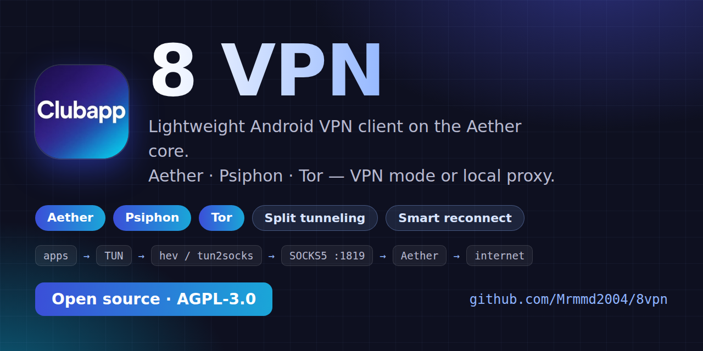
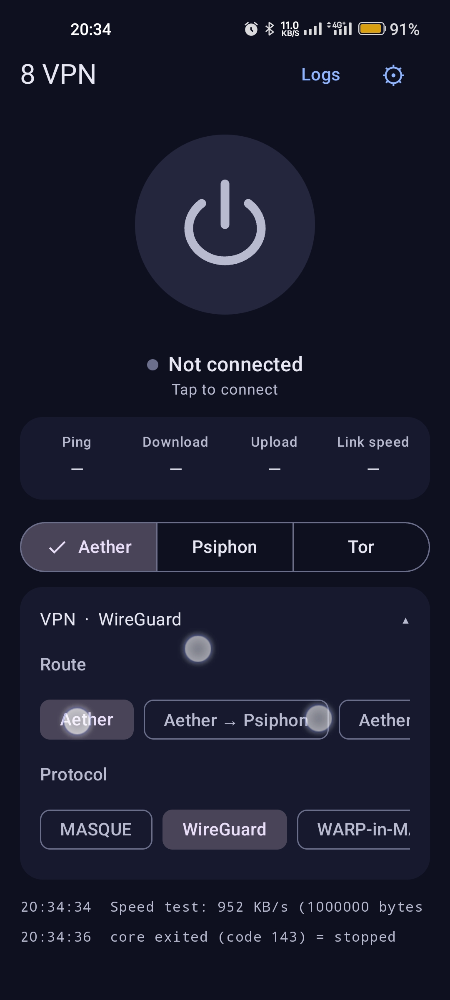
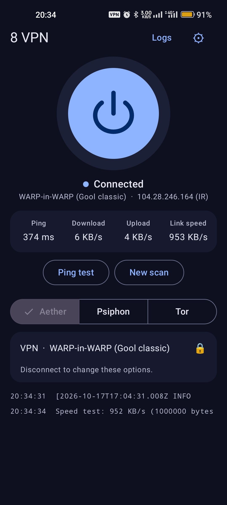
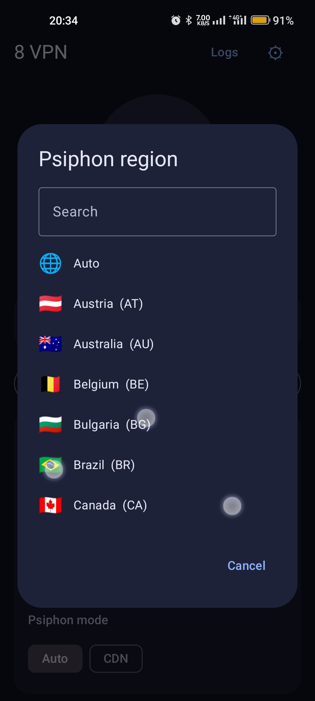
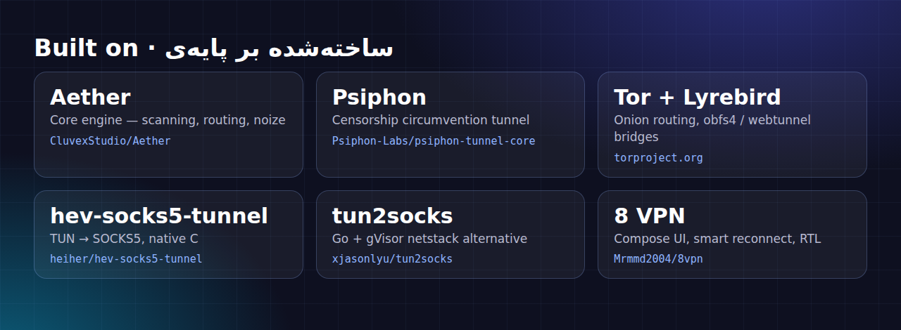
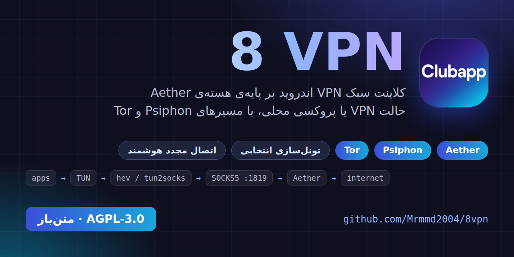

<div align="center">



**[English](#english) · [فارسی](#فارسی)**

[](https://t.me/Clubapp8)
[](LICENSE)


</div>

---

<a id="english"></a>

# 8 VPN — English

A lightweight Android VPN client built on the **Aether** core and **hev-socks5-tunnel**.
Jetpack Compose, Material 3, dark by default, English and Persian (RTL).

📢 Telegram channel: <https://t.me/Clubapp8>

## Features

- **Two modes**: VPN (the whole device goes through the tunnel) or Proxy-only (a local SOCKS5 and optional HTTP proxy).
- **Route switcher**: Aether, Psiphon or Tor (Aether protocols: MASQUE, WireGuard, WARP-in-MASQUE, WARP-in-WARP), with Psiphon region selection and Tor bridge options.
- **Smart reconnect**: reconnects when the core dies, when pings fail, or when the network changes (Wi-Fi ↔ mobile data), then retries with a fresh scan.
- **Split tunneling**: include only selected apps or exclude them.
- **Two TUN engines**: hev-socks5-tunnel, with tun2socks (Go + gVisor) as an alternative.
- **Live info**: ping, download/upload speed, exit IP, logs.
- Quick Settings tile, start on boot, dynamic color (Android 12+), dark / light theme.
- English and Persian UI with full RTL support.

## Screenshots

<p align="center">
  
  
  
</p>

## How it works

```
apps -> VpnService (TUN) -> hev-socks5-tunnel -> SOCKS5 127.0.0.1:1819 -> Aether -> internet
```

Ports: SOCKS5 `1819` (configurable), Tor `1820`, Psiphon `1821`, optional HTTP `1822`.

## Engines and credits



| Component | Role | Link | License |
|---|---|---|---|
| **Aether** (CluvexStudio) | Core engine used for every route | <https://github.com/CluvexStudio/Aether> | AGPL-3.0 |
| **Psiphon** (psiphon-tunnel-core) | Censorship circumvention route | <https://github.com/Psiphon-Labs/psiphon-tunnel-core> | GPL-3.0 |
| **Tor** | Onion routing route | <https://www.torproject.org> | BSD-3-Clause |
| **Lyrebird** | Tor pluggable transports (obfs4, webtunnel) | <https://gitlab.torproject.org/tpo/anti-censorship/pluggable-transports/lyrebird> | BSD-3-Clause |
| **hev-socks5-tunnel** | TUN → SOCKS5 engine (default) | <https://github.com/heiher/hev-socks5-tunnel> | MIT |
| **tun2socks** | Alternative TUN → SOCKS5 engine (Go + gVisor) | <https://github.com/xjasonlyu/tun2socks> | GPL-3.0 |

> Please check each upstream repository for its current license terms.

## Build with GitHub Actions

1. Upload this project to your repository (`Mrmmd2004/8vpn`).
2. Open **Actions → Build APKs → Run workflow** (or push to `main`, or push a tag like `v1.0.0` to also create a release).
3. Download the `8VPN-apks` artifact:
   `8VPN-armeabi-v7a.apk`, `8VPN-arm64-v8a.apk`, `8VPN-universal.apk` (v7a + v8a + x86_64).

The first build is slow (Rust + BoringSSL + Tor + Go for three ABIs). The workflow also builds `libt2s-jni.so` (tun2socks);
if that step fails, the build still succeeds and the app uses hev only.

**Signing (optional).** Without secrets the APKs are signed with a debug key. For a stable key add these repository secrets:
`KEYSTORE_BASE64`, `KEYSTORE_PASSWORD`, `KEY_ALIAS`, `KEY_PASSWORD`.

**Versions.** `AETHER_REF` and `HEV_REF` at the top of `.github/workflows/main.yml` pick the upstream versions.
The default Aether ref is commit `21e7150` (v2.3.0 without pull request #141); pass `aether_ref` = `v2.3.0` or `v2.1.0` when running the workflow by hand to compare.

## Notes

- Aether is AGPL-3.0, so this project is AGPL-3.0 too (see [LICENSE](LICENSE)).
- Aether's trademark policy asks derivative products to use their own name and branding, so the app is named **8 VPN** and the core is only credited.
- The Psiphon region list is static; the real set depends on Psiphon's servers.

---

<a id="فارسی"></a>

<div dir="rtl" align="right">



# 8 VPN — فارسی

یک کلاینت سبک VPN برای اندروید، ساخته‌شده روی هسته‌ی **Aether** و **hev-socks5-tunnel**.
با Jetpack Compose و Material 3، پیش‌فرض تیره، با رابط فارسی (راست‌به‌چپ) و انگلیسی.

📢 کانال تلگرام: <https://t.me/Clubapp8>

## امکانات

- **دو حالت**: VPN (کل دستگاه از تونل رد می‌شود) یا فقط پروکسی (یک SOCKS5 محلی و در صورت نیاز پروکسی HTTP).
- **انتخاب مسیر**: Aether، Psiphon یا Tor (پروتکل‌های Aether: MASQUE و WireGuard و WARP-in-MASQUE و WARP-in-WARP)، همراه با انتخاب منطقه‌ی Psiphon و گزینه‌های بریج Tor.
- **اتصال مجدد هوشمند**: اگر هسته از کار بیفتد، پینگ‌ها شکست بخورند یا شبکه عوض شود (وای‌فای ↔ دیتای موبایل) دوباره وصل می‌شود و در صورت لزوم با اسکن تازه تلاش می‌کند.
- **تونل‌سازی انتخابی (Split tunneling)**: فقط برنامه‌های انتخاب‌شده یا همه به‌جز آن‌ها.
- **دو موتور TUN**: hev-socks5-tunnel و به‌عنوان جایگزین tun2socks (Go + gVisor).
- **اطلاعات زنده**: پینگ، سرعت دانلود و آپلود، IP خروجی و لاگ‌ها.
- کاشی تنظیمات سریع، اجرا هنگام بوت، رنگ پویا (اندروید ۱۲+)، تم تیره و روشن.
- رابط فارسی و انگلیسی با پشتیبانی کامل از راست‌به‌چپ.

## تصاویر برنامه

<p align="center">
  
  
  
</p>

## نحوه‌ی کار

</div>

```
apps -> VpnService (TUN) -> hev-socks5-tunnel -> SOCKS5 127.0.0.1:1819 -> Aether -> internet
```

<div dir="rtl" align="right">

پورت‌ها: SOCKS5 روی `1819` (قابل تغییر)، Tor روی `1820`، Psiphon روی `1821` و HTTP اختیاری روی `1822`.

## موتورها و منابع


</div>

<div dir="rtl" align="right">

| مولفه | نقش | لینک | مجوز |
|---|---|---|---|
| **Aether** (CluvexStudio) | هسته‌ی اصلی برای همه‌ی مسیرها | <https://github.com/CluvexStudio/Aether> | AGPL-3.0 |
| **Psiphon** (psiphon-tunnel-core) | مسیر عبور از فیلترینگ | <https://github.com/Psiphon-Labs/psiphon-tunnel-core> | GPL-3.0 |
| **Tor** | مسیر روتینگ پیازی | <https://www.torproject.org> | BSD-3-Clause |
| **Lyrebird** | پلاگین‌های ترنسپورت Tor (obfs4 و webtunnel) | <https://gitlab.torproject.org/tpo/anti-censorship/pluggable-transports/lyrebird> | BSD-3-Clause |
| **hev-socks5-tunnel** | موتور پیش‌فرض TUN به SOCKS5 | <https://github.com/heiher/hev-socks5-tunnel> | MIT |
| **tun2socks** | موتور جایگزین TUN به SOCKS5 (Go + gVisor) | <https://github.com/xjasonlyu/tun2socks> | GPL-3.0 |

> مجوز دقیق و فعلی هر پروژه را در مخزن اصلی خودش بررسی کنید.

## ساخت با GitHub Actions

1. پروژه را در مخزن خودتان (`Mrmmd2004/8vpn`) آپلود کنید.
2. به **Actions ← Build APKs ← Run workflow** بروید (یا روی `main` پوش کنید، یا یک تگ مثل `v1.0.0` بزنید تا ریلیز هم ساخته شود).
3. آرتیفکت `8VPN-apks` را دانلود کنید:
   `8VPN-armeabi-v7a.apk`، `8VPN-arm64-v8a.apk` و `8VPN-universal.apk` (شامل v7a و v8a و x86_64).

بیلد اول کند است (Rust و BoringSSL و Tor و Go برای سه معماری). ورک‌فلو کتابخانه‌ی `libt2s-jni.so` (tun2socks) را هم می‌سازد؛
اگر آن مرحله خطا بدهد، بیلد باز هم موفق می‌شود و برنامه فقط از hev استفاده می‌کند.

**امضا (اختیاری).** بدون سکرت، APKها با کلید دیباگ امضا می‌شوند. برای کلید ثابت این سکرت‌ها را به مخزن اضافه کنید:
`KEYSTORE_BASE64` و `KEYSTORE_PASSWORD` و `KEY_ALIAS` و `KEY_PASSWORD`.

**نسخه‌ها.** مقادیر `AETHER_REF` و `HEV_REF` بالای فایل `.github/workflows/main.yml` نسخه‌ی پروژه‌های بالادستی را مشخص می‌کنند.
مقدار پیش‌فرض Aether کامیت `21e7150` است (نسخه‌ی v2.3.0 بدون pull request شماره‌ی ۱۴۱). برای مقایسه، هنگام اجرای دستی ورک‌فلو مقدار `aether_ref` را `v2.3.0` یا `v2.1.0` بگذارید.

## نکته‌ها

- Aether مجوز AGPL-3.0 دارد، پس این پروژه هم AGPL-3.0 است (فایل [LICENSE](LICENSE)).
- سیاست علامت تجاری Aether از محصولات مشتق می‌خواهد نام و برند خودشان را داشته باشند؛ برای همین برنامه **8 VPN** نام دارد و از هسته فقط به‌عنوان منبع یاد می‌شود.
- فهرست مناطق Psiphon ثابت است و مجموعه‌ی واقعی به سرورهای Psiphon بستگی دارد.

</div>
